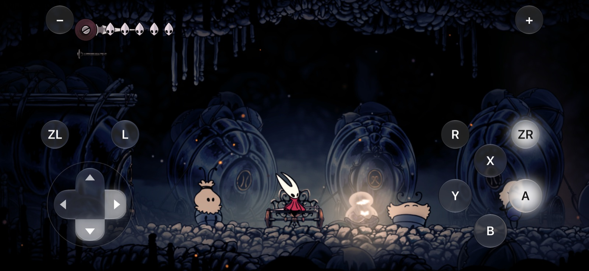
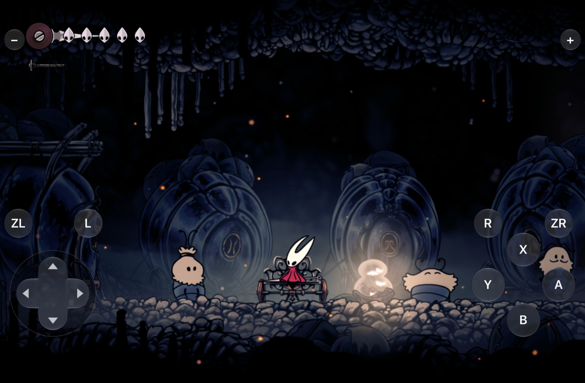
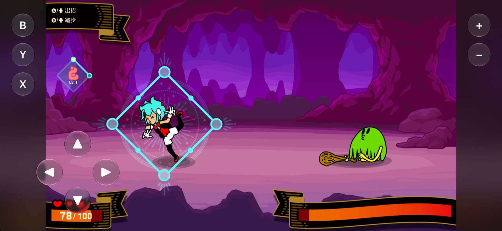
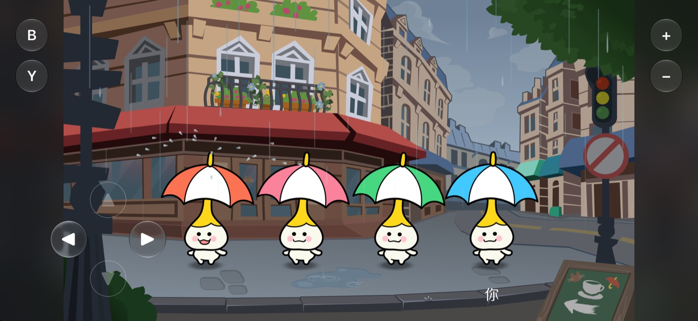

# Screenshots

These screenshots come from the iOS Simulator on iPhone and iPad test builds.

## Hollow Knight: Silksong

Liquid Glass virtual controller on iPhone. The picture fills the wide screen.

The same game on iPad. The controls move to fit the 3:2 screen.

## Rhythm Heaven

BeatSpell with a small D-pad and only the buttons that the level uses.

The umbrella level shows fewer buttons, so they cover less of the picture.

---

Game names and artwork belong to their owners. See [License and disclaimer](README.md#license-and-disclaimer).
